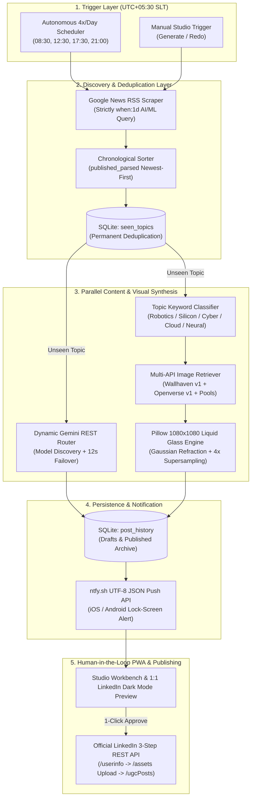

<div align="center">

# 🧠 Autonomous LinkedIn AI/ML Agent Studio (`v1.5.0`)
### *Human-in-the-Loop (HITL) AI News Discovery, Liquid Glass Visual Synthesis & Auto-Publishing PWA*

[](https://github.com/shehannadeesha/Linkedin-ai-agent-pwa)
[](https://www.python.org/)
[](https://fastapi.tiangolo.com/)
[](https://ai.google.dev/)
[](https://developer.linkedin.com/)
[](./CASE_STUDY.md)

<p align="center">
  <b>Built by <a href="https://www.linkedin.com/in/shehan-nadeesha/">Shehan Nadeesha</a> (AI/ML Engineer)</b><br>
  <i>An autonomous 24/7 background AI agent that curates real-time 24h AI/ML breakthroughs, writes technical LinkedIn commentary, renders 1080×1080 Apple iOS Liquid Glass cards, sends mobile lock-screen push alerts, and publishes directly to LinkedIn with one tap.</i>
</p>

[📘 Read the Full Engineering Case Study](./CASE_STUDY.md) • [🏗️ System Architecture](#-system-architecture--7-stage-pipeline) • [⚡ Quick Start (Simulation Mode)](#-quick-start-run-locally-in-simulation-mode)

</div>

---

## 🎯 Overview & Problem Statement

Maintaining an active, high-signal technical presence on LinkedIn as an **AI/ML Engineer** requires daily monitoring of fast-moving research, LLM releases, and hardware breakthroughs, followed by copywriting and visual design. 
* Doing this manually takes **1–2 hours every day**.
* **100% blind automation** risks publishing hallucinated facts, duplicate topics, or watermarked low-quality visuals directly to a professional profile.

**Agent Studio (`v1.5.0`)** solves this using a **Human-in-the-Loop (HITL)** architecture:
1. **95% Autonomous Execution:** At 4 peak daily intervals (`08:30`, `12:30`, `17:30`, `21:00` SLT), the agent scrapes strictly the **last 24 hours of AI/ML news**, filters out any previously seen topics via SQLite, synthesizes an engineer-grade LinkedIn post, programmatically generates a **100% watermark-free `1080×1080` Apple iOS Liquid Glass visual card**, and pushes an alert to my iPhone lock screen.
2. **5% Human Final Control:** Opening the mobile/desktop PWA displays a **1:1 authentic LinkedIn Dark Mode feed preview** where I can edit the caption, regenerate (`Redo`) the angle/visual, or tap **Approve & Publish** to push live via the **Official LinkedIn OAuth 2.0 API**.

> 🔒 **Why the Live Cloud URL is Private:** Because the production cloud deployment is authenticated with my live personal `LINKEDIN_ACCESS_TOKEN` (`w_member_social` scope), it is protected behind a custom **SHA-256 HMAC Passcode Middleware**. Reviewers can inspect the [Engineering Case Study](./CASE_STUDY.md) or run the entire Studio locally in **Simulation Mode** in under 60 seconds.

---

## ✨ Key Engineering Features

| Feature | Technical Implementation |
| :--- | :--- |
| 🕒 **24/7 Autonomous 4x/Day Scheduler** | Non-blocking `asyncio` background daemon locked to Sri Lanka Standard Time (`UTC+05:30`) triggering at peak LinkedIn engagement hours (`08:30`, `12:30`, `17:30`, `21:00`). |
| 📰 **Strictly 24h Chronological News Discovery** | Queries Google News RSS (`when:1d`) for `AI`, `Machine Learning`, `LLM`, and `Deep Learning`, sorting entries newest-first via `published_parsed` UNIX timestamps. |
| 🛡️ **Zero-Duplicate Dual-Table SQLite Guard** | Separates permanent topic fingerprints (`seen_topics`) from mutable UI records (`post_history`). Even if a draft is deleted from the UI, the topic will never be regenerated. |
| 🧠 **Dynamic Gemini REST Failover Router** | Queries `/v1beta/models` at runtime to discover active models and routes requests across `gemma-3-27b-it`, `gemini-2.0-flash-lite`, and `gemini-2.0-flash` with a strict 12s failover timeout. |
| 🎨 **1080×1080 iOS Liquid Glass Visual Engine** | Deterministic `Pillow (PIL)` pipeline featuring frosted Gaussian blur refraction (`radius=34`), **4x supersampled anti-aliasing** (`LANCZOS`), and pixel-measured text wrapping (`draw.textbbox`). |
| 🖼️ **Context-Aware Dynamic Background Search** | Classifies headline keywords (`robotics`, `hardware/nvidia`, `security`, `coding`, `cloud`, `neural`) and fetches fresh high-res imagery via **Wallhaven API v1** & **Openverse API v1** with a 25-item LRU cache. |
| 📱 **Accountless iOS/Android Push Alerts** | Dispatches UTF-8 JSON push notifications via `ntfy.sh` directly to the phone lock screen the moment a new draft is synthesized. |
| 👀 **1:1 LinkedIn Dark Mode Feed Preview** | Authentic `#1b1f23` dark-mode card (`555px` desktop / edge-to-edge mobile) with `#70b5f9` hashtag/URL highlighting, expandable `…more` truncation, and official reaction/action SVG bars. |
| 🚀 **Official LinkedIn 3-Step UGC Publisher** | Resolves `/v2/userinfo` Member URN, registers & streams binary `1080×1080` JPEG assets via `/v2/assets?action=registerUpload`, and publishes public posts to `/v2/ugcPosts`. |

---

## 🏗️ System Architecture & 7-Stage Pipeline



---

## 📂 Repository Structure

```text
Linkedin-ai-agent-pwa/
├── app/
│   ├── __init__.py
│   ├── agent.py              # 24h RSS scraper, dynamic Gemini router & 1080x1080 Pillow Liquid Glass engine
│   ├── storage.py            # Dual-table SQLite persistence (seen_topics + post_history) & archive stats
│   ├── scheduler.py          # 24/7 SLT (UTC+05:30) 4x/day background loop & ntfy.sh UTF-8 push sender
│   ├── linkedin_service.py   # Official LinkedIn OAuth 2.0 3-step binary image + UGC post publisher
│   └── main.py               # FastAPI REST endpoints & application lifecycle manager
├── static/
│   ├── index.html            # Widescreen Dark Mode Studio UI, 1:1 LinkedIn Preview & Mobile PWA
│   ├── manifest.json         # iOS / Android Progressive Web App manifest
│   └── sw.js                 # Service Worker for standalone PWA installation
├── app.py                    # Cloud ASGI launcher with SHA-256 HMAC Passcode Lock Middleware
├── CASE_STUDY.md             # Deep-dive engineering case study, benchmarks & troubleshooting log
├── render.yaml               # Cloud deployment blueprint
├── requirements.txt          # Python dependencies
└── README.md                 # Project documentation
```

---

## 🔌 REST API Endpoints (`app/main.py`)

| Method | Endpoint | Description |
| :--- | :--- | :--- |
| `GET` | `/` | Serves the Human-in-the-Loop Studio Workbench PWA (`static/index.html`). |
| `GET` | `/api/meta` | Lightweight public health-check & version endpoint for 24/7 keep-alive cron pings. |
| `GET` | `/api/draft` | Returns the latest active draft, archive statistics, and scheduler status. |
| `POST` | `/api/generate` | Scrapes the newest unseen 24h AI/ML news, writes post copy, and renders a `1080×1080` card. |
| `POST` | `/api/regenerate` | (`Redo`) Regenerates a fresh post angle and selects a new background image for the current topic. |
| `POST` | `/api/publish` | Publishes the approved draft + `1080×1080` visual card to LinkedIn (or Simulation Mode). |
| `GET` | `/api/history` | Returns the full SQLite post archive (`All`, `Published`, `Drafts`) with stats. |
| `DELETE` | `/api/history/{id}` | Deletes a specific draft while keeping its topic marked as seen in `seen_topics`. |
| `DELETE` | `/api/history/drafts/clear` | Bulk-deletes all unpublished drafts while preserving published history. |
| `GET/POST` | `/api/scheduler` | Reads or updates the 4 daily time slots, Auto-Pilot toggle, and `ntfy.sh` push topic. |
| `POST` | `/api/scheduler/test-notification` | Sends an instant test push notification to the configured mobile device. |
| `GET/POST` | `/api/profile` | Manages author identity (`Shehan Nadeesha`, `AI/ML Engineer`) and custom avatar upload. |
| `GET/POST` | `/api/linkedin/token` | Verifies and stores the LinkedIn OAuth 2.0 `w_member_social` access token. |

---

## ⚡ Quick Start (Run Locally in Simulation Mode)

Anyone reviewing this project can run the full Studio locally in **Simulation Mode** (no LinkedIn token required—only a free Google AI Studio Gemini API key):

### 1. Clone & Set Up Environment
```bash
git clone https://github.com/shehannadeesha/Linkedin-ai-agent-pwa.git
cd Linkedin-ai-agent-pwa

python -m venv venv
# Windows:
venv\Scripts\activate
# macOS / Linux:
# source venv/bin/activate

pip install -r requirements.txt
```

### 2. Configure Environment Variables
Create a `.env` file in the root directory:
```env
# Required: Free API key from https://aistudio.google.com/
GEMINI_API_KEY=your_gemini_api_key_here

# Optional: Official LinkedIn OAuth 2.0 Token (Leave blank to use Simulation Mode)
LINKEDIN_ACCESS_TOKEN=

# Optional: Default ntfy.sh topic for mobile push notifications
NTFY_TOPIC=

# Optional: Passcode lock when running via app.py in the cloud
STUDIO_PASSWORD=
```

### 3. Launch the Studio Server
```bash
uvicorn app.main:app --reload --port 8000
```
Open **`http://localhost:8000`** in your browser to test live 24h AI/ML news discovery, `1080×1080` Liquid Glass visual card generation, `Redo` regeneration, and the 1:1 LinkedIn Dark Mode feed preview!

---

## 👤 Author

**Shehan Nadeesha**  
*AI/ML Engineer*  
🔗 **LinkedIn:** [linkedin.com/in/shehan-nadeesha](https://www.linkedin.com/in/shehan-nadeesha/)  
🐙 **GitHub:** [github.com/shehannadeesha](https://github.com/shehannadeesha)

---
<div align="center">
  <i>If you found this autonomous agent architecture interesting, feel free to ⭐ star the repository!</i>
</div>